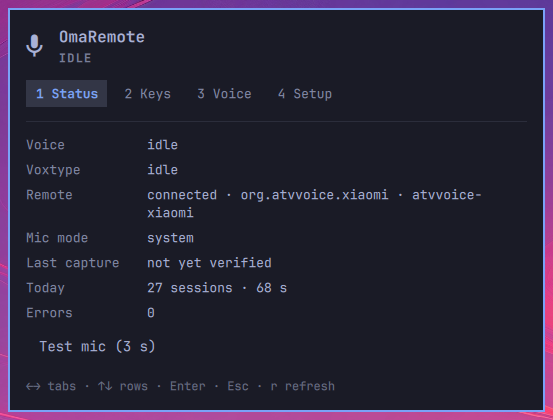
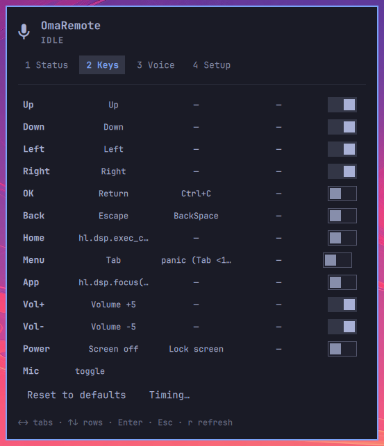
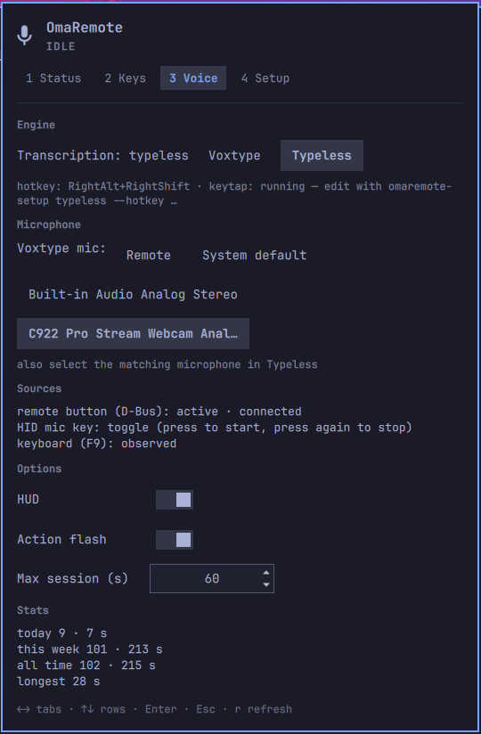
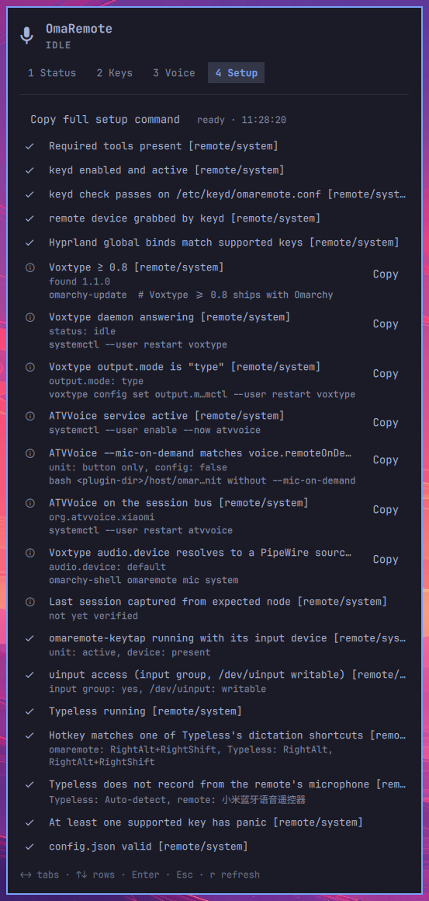

# OmaRemote

**English** · [繁體中文](README.zh-TW.md)

An [Omarchy](https://omarchy.org) plugin that turns an ATVV-class Bluetooth voice remote into a couch controller.
Hold the mic button to dictate into the focused window, and use the other 12 buttons as configurable shortcuts.

Developed and tested with the **Xiaomi Bluetooth Voice Remote (小米蓝牙语音遥控器, RC003, `2717:32b8`)**.
The design targets the wider ATVV family (e.g. G20S Pro).

<p align="center">
  
</p>

## Features

- **Dictation from the remote.** Hold the mic button and speak; the text is typed into the focused window.
  - **Voxtype** engine (default): local Whisper through Omarchy's Voxtype.
  - **Typeless** engine (optional): the remote triggers Typeless, which records,
    transcribes and pastes on its own.
- **Two microphone modes.**
  - `remote`: the remote's own microphone, streamed over Bluetooth through [ATVVoice](https://github.com/b0o/ATVVoice).
    Hold to talk, release to finish.
  - `system`: your desktop microphone. Each press of the mic button starts or stops dictation.
  - In `system` mode, pick the microphone in the Voice tab, or run `omarchy-shell omaremote micSystem <node>`;
    `omarchy-shell omaremote micSources` lists the node names. If the answer says `refreshing` or
    `sourcesRefreshing`, run it again a moment later. Only Voxtype is affected; Typeless keeps its own
    microphone setting.
- **13-key mapping engine.** Per key: tap, hold, double-tap and repeat. Actions can send keys, run Hyprland
  dispatchers, change the volume, control media (`playerctl`), or turn off or lock the screen.
  Holding the panic key (Menu by default) resets everything.
- **Bar widget, panel and HUD.** The bar shows the dictation state. The panel has Status, Keys, Voice and Setup tabs,
  all keyboard-navigable. An on-screen HUD shows recording time and errors.
- **Doctor.** The Setup tab checks every host prerequisite and gives a copyable fix for each failing one.

## Screenshots

| Status | Keys |
|---|---|
|  |  |
| **Voice** | **Setup (Doctor)** |
|  |  |

- **Status:** voice and Voxtype state, the remote's connection, mic mode, today's sessions, and a 3-second mic test.
- **Keys:** the action for each button's tap, hold and double-tap, with the repeat switch. Edit in place, reset to the
  defaults, or tune the timing.
- **Voice:** the transcription engine, the microphone mode and source, which trigger sources are active, the HUD options, the
  session length limit, and usage stats.
- **Setup:** Doctor checks for keyd, the Hyprland binds, Voxtype, ATVVoice, the Typeless keytap and the config file.

## Requirements

- Omarchy with the Lua Hyprland config (Hyprland's `global` dispatcher).
- `keyd` ≥ 2.5, PipeWire (`pw-dump`, `wpctl`), `jq`, `playerctl`.
- Voxtype ≥ 0.8. It ships with Omarchy.
- `remote` mic mode only: `git` and `cargo`, to build ATVVoice.
- Typeless engine only: Typeless, and membership in the `input` group.

## Install

```bash
git clone https://github.com/kehao-playground/omaremote.git
cd omaremote
make dev-install                 # copy the plugin into ~/.config/omarchy/plugins and rescan
bash host/omaremote-setup        # every host step in order (interactive; keyd and verify use sudo)
```

Then add **OmaRemote** to the bar, and open the panel's **Setup** tab: every row should show ✓.

`omaremote-setup` runs these steps in order. Each step can also be run on its own:

| step | what it does |
|---|---|
| `deps` | checks host tools and reports what to install (installs nothing itself) |
| `keyd` | stages and validates `/etc/keyd/omaremote.conf` (remote buttons → F13–F24 / XF86Xfer), then guides enabling keyd |
| `binds` | sets the xkb option and generates `~/.config/hypr/omaremote.lua` |
| `plugin` | checks that the plugin is installed and its service answers |
| `atvvoice` | builds ATVVoice (pinned revision plus a decoder patch), writes its user unit, and defines the ALSA PCM Voxtype records from |
| `mic` | applies a mic mode: `remote` or `system` |
| `verify` | verifies the loaded binds and sweeps every button through the transport |

Use `--mic system` to skip ATVVoice and dictate from your desktop microphone.

## Usage

**Default buttons**

| button | tap | hold |
|---|---|---|
| D-pad | arrow keys (repeat while held) | |
| OK | Return | Ctrl+C |
| Back | Escape | BackSpace |
| Home | Omarchy menu | |
| Menu | Tab | **panic reset** (1.5 s) |
| TV / app | next workspace | |
| Vol + / − | volume ±5 % (repeat) | |
| Power | screen off | lock screen |
| Mic | dictation | |

Change any of these in the **Keys** tab. Settings are stored in `~/.config/omaremote/config.json`; edits made to that
file by hand are picked up at once.

**Dictation**

- `remote` mode: hold the mic button, speak, and release.
- `system` mode: press once to start, and press again to stop.
- Keyboard F9 (Omarchy's own Voxtype binding) keeps working. OmaRemote observes it and never interrupts it.

## Typeless engine (optional)

With **Engine: Typeless** (Voice tab), the mic button sends Typeless's dictation hotkey instead of driving Voxtype.
Typeless records, transcribes and pastes by itself. Choose its microphone in Typeless.

1. Run `bash host/omaremote-setup typeless`. It installs the `omaremote-keytap` user service, a uinput keyboard
   that needs the `input` group (Typeless needs that group too). On the first run it adopts Typeless's dictation
   hotkey. Use `--hotkey RightAlt+RightShift` to pick another, or `--hotkey-from-typeless` to read Typeless's again.
   Setup never switches the engine.
2. Switch the engine in the panel: **Voice → Engine: Typeless**.
3. Pick the matching microphone in Typeless:
   - `remote` mode: select the remote (小米蓝牙语音遥控器). Hold to talk.
   - `system` mode: select your desktop microphone or Auto-detect. Each press toggles Typeless.

Notes:

- In `remote` mode the start waits for the remote's own key press (at most `voice.typeless.pressWaitMs`, default
  250 ms), because Typeless ignores its hotkey when another key event lands inside it. For the same reason
  `omaremote-setup keyd` maps the mic key to a single pulse (`macro2(0, 0, xfer)`). Re-run it after upgrading.
- Typeless may hold several dictation shortcuts. Doctor passes when OmaRemote's hotkey matches any one of them.
- **Known limitation:** OmaRemote cannot see Typeless's real state. Pressing the hotkey on the keyboard, Typeless
  stopping by itself (on silence or at its length limit), or a tap with an unknown result can leave the two
  inverted, so every later hold toggles the wrong way. To recover:
  1. stop Typeless by hand;
  2. press reset if the bar shows the Typeless warning;
  3. hold again.
- After restarting the shell during a dictation, check Typeless: it may still be recording.

## Troubleshooting

- Open the **Setup** tab first. Every failing row has a fix command you can copy.
- **The mic button does nothing, but the other buttons work** (`remote` mode): restart ATVVoice with
  `systemctl --user restart atvvoice`. This was seen once, and its cause is still unknown.
- **Stuck state:** hold the panic key (Menu) for 1.5 s, or run `omarchy-shell omaremote reset`.

## Development

```bash
make test          # node --test (pure lib)
make lint          # qmllint + omarchy plugin validate
make integration   # second Quickshell instance + bash fakes; never touches the live shell or ~/.config/omaremote
make check         # all of the above, plus the keytap, CommandRunner and setup tests
make dev-install   # rsync into ~/.config/omarchy/plugins/io.github.kehao-chen.omaremote and rescan
make dev-restart   # + omarchy-restart-shell (needed for Service.qml changes: keepLoaded services survive rescans)
```

IPC (`omarchy-shell omaremote …`): `ping`, `status`, `doctor`, `key <name> down|up`, `voice state <state>`,
`voice poll -`, `reset`, `mic remote|system`, `micSystem <node>|default`, `micSources`, `micStatus <id>`, `micToggle`, `engine voxtype|typeless`,
`typelessHotkey <chord>`, `selftestPing`, `selftestArm`, `selftestStatus|selftestReport|selftestDisarm <id>`.

Design documents are in `docs/superpowers/specs/`: the core design (`2026-09-14-omaremote-design.md`), host setup
(`2026-10-02-omaremote-host-setup-design.md`), the remote microphone (`2026-10-12-remote-mic-design.md`) and the
Typeless engine (`2026-10-13-typeless-engine-design.md`).

## License

GPL-3.0-only.
